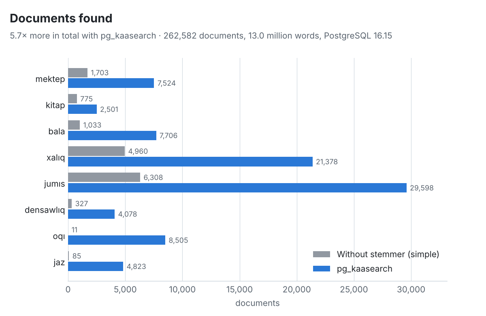
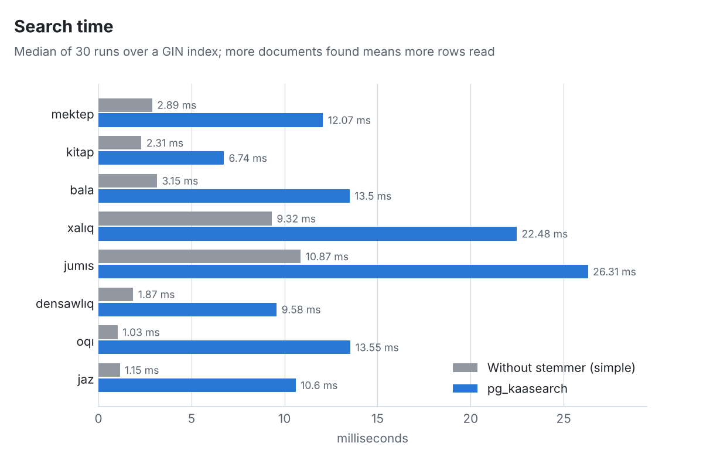
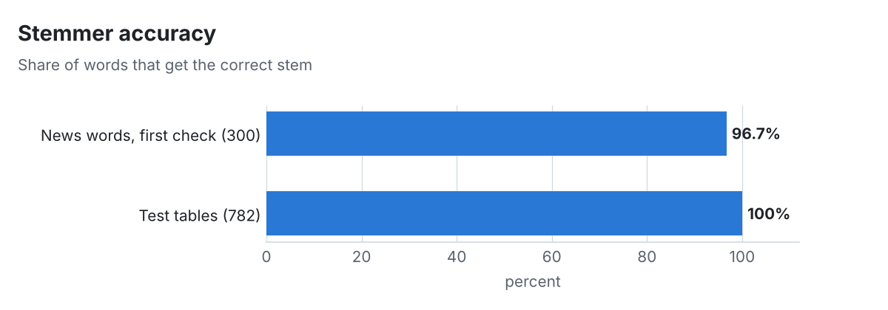
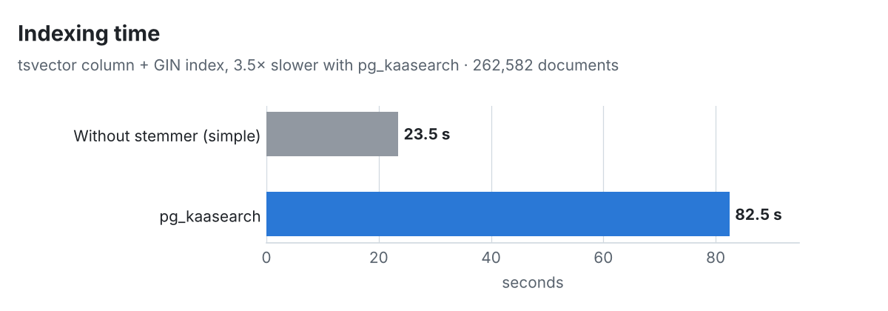

# pg_kaasearch

Full-text search for the Karakalpak language in PostgreSQL. It finds every
form of a word, searches Latin and Cyrillic text alike, reads the
apostrophe spelling and drops stop words.

## Example

```sql
CREATE EXTENSION pg_kaasearch;

SELECT to_tsvector('kaasearch', 'Bizler mektebimizde jańa kitaplardı oqıdıq.');
-- 'jańa':3 'kitap':4 'mektep':2 'oqı':5

SELECT to_tsvector('kaasearch', 'Мектепке барған балалар китап оқыйды.')
    @@ to_tsquery('kaasearch', 'mektep & kitap');
-- true
```

## Benchmarks

Measured on 262,582 Karakalpak documents (news, health and parallel texts, 13 million words);
the numbers are in [docs/bench/results.json](docs/bench/results.json).

<picture>
  <source media="(prefers-color-scheme: dark)" srcset="docs/bench/documents-dark.png">
  
</picture>

<picture>
  <source media="(prefers-color-scheme: dark)" srcset="docs/bench/search_time-dark.png">
  
</picture>

<picture>
  <source media="(prefers-color-scheme: dark)" srcset="docs/bench/accuracy-dark.png">
  
</picture>

<picture>
  <source media="(prefers-color-scheme: dark)" srcset="docs/bench/indexing-dark.png">
  
</picture>
## Install

**Docker** (PostgreSQL 15–18, the extension is already enabled):

```sh
docker run -e POSTGRES_PASSWORD=secret -p 5432:5432 ghcr.io/erinshek/pg_kaasearch:pg18
```

**Ubuntu / Debian:** download the package for your system and PostgreSQL version from
[Releases](https://github.com/erinshek/pg-kaasearch/releases), then:

```sh
sudo apt install ./postgresql-18-kaasearch_1.0.0-1.noble_amd64.deb
```

**From source** (needs the PostgreSQL development files, a C compiler and `make`):

```sh
git clone https://github.com/erinshek/pg-kaasearch.git
cd pg-kaasearch
make && sudo make install
```

Then enable it in your database (it must use the UTF8 encoding):

```sql
CREATE EXTENSION pg_kaasearch;
```

## Usage

```sql
-- index a text column once
CREATE INDEX ON articles USING gin (to_tsvector('kaasearch', body));

-- search it: finds mektebimizde, mektepke, Мектепке ...
SELECT title FROM articles
WHERE to_tsvector('kaasearch', body) @@ websearch_to_tsquery('kaasearch', 'mektep');
```

## License

[MIT License](LICENSE)
